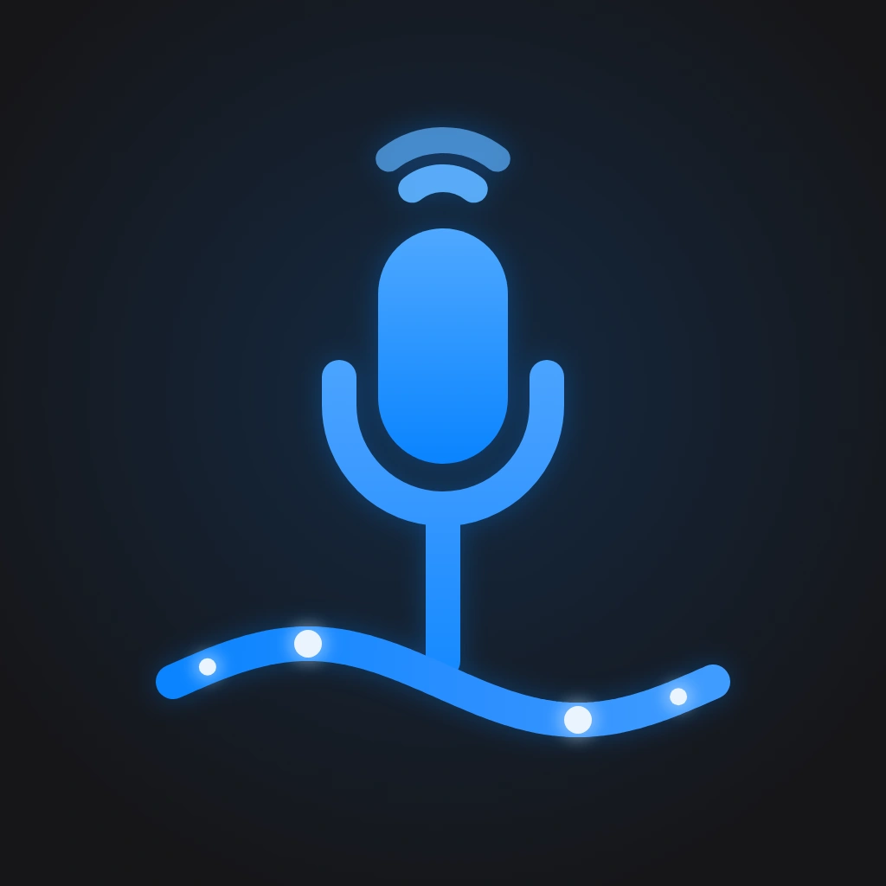
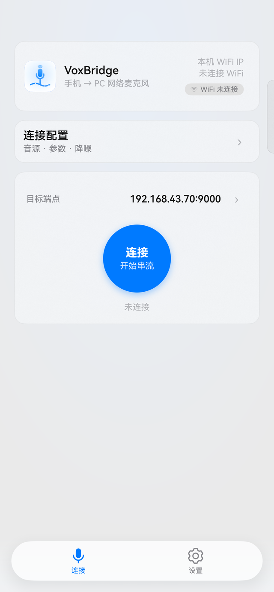
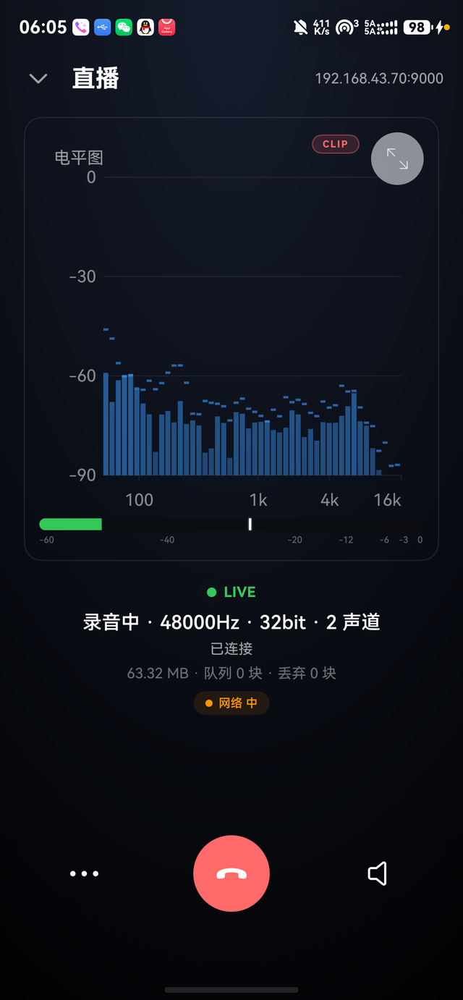
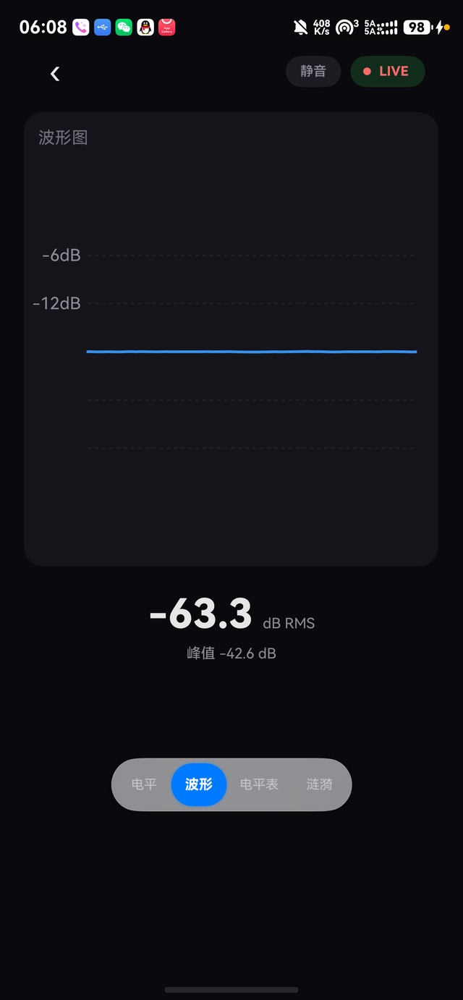
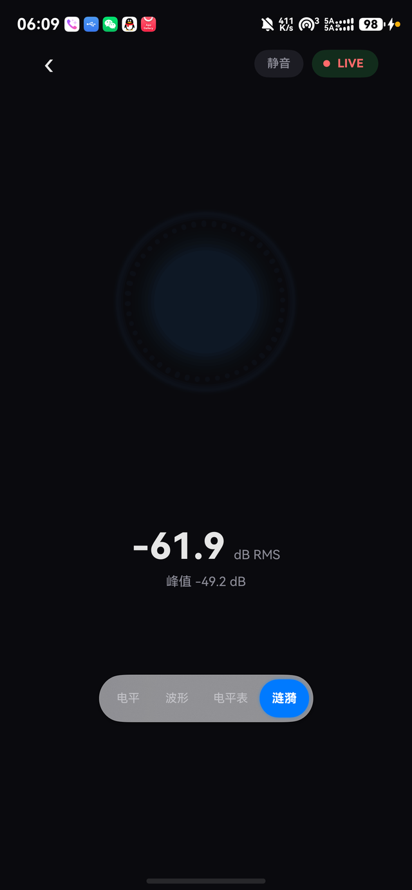
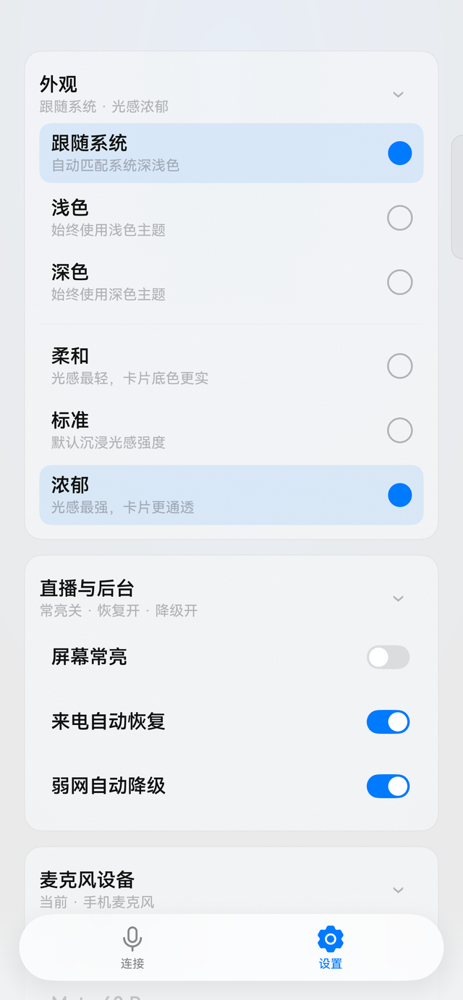
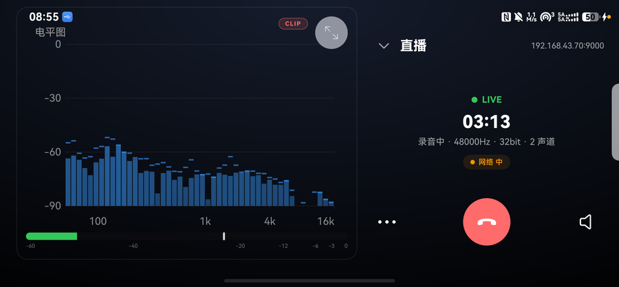
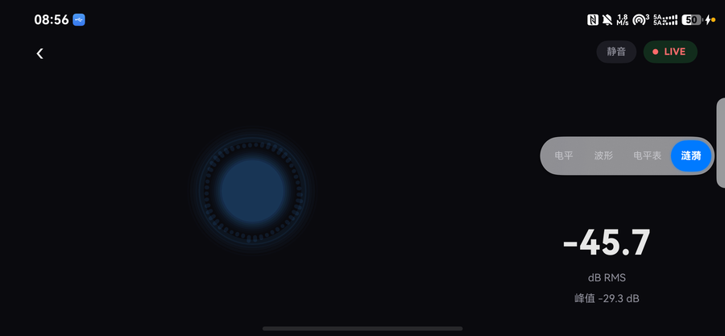

<div align="center">

<h1>VoxBridge</h1>



<br>

<a href="./README.md">English</a> | <a href="./README_zh-cn.md">简体中文</a> | <b>繁體中文</b>

<br>

<a href="./LICENSE"></a>


<br>
<br>

VoxBridge 可將 HarmonyOS 手機變為高品質的 PC 麥克風。

原生鴻蒙應用 · 區域網路串流 · MicYou 桌面端相容

<br>

*本專案由 AI 在人類監督下完成。*

</div>

## 主要功能

- 以最高 48 kHz / 24 bit 擷取人聲（弱網自動降級至 16 kHz / 16 bit）
- 端上音訊處理：5 段 RBJ 等化器、AGC、限幅器與 DeepFilterNet3 降噪
- 四種即時可視化——頻譜、波形、電平表與漣漪——透過可拖曳懸浮 Dock 切換，橫豎屏自適應
- 雙協定串流：MicYou 桌面端（連接埠 9123）或任意 VoxBridge 協定接收端（連接埠 9000）
- 淺色/深色主題、沉浸式材質與鎖定畫面媒體工作階段卡片

## 軟體截圖

**直向**

| 連接 | 直播 | 波形 |
|:---:|:---:|:---:|
|  |  |  |

| 漣漪 | 設定 |
|:---:|:---:|
|  |  |

**橫向**

| 直播 | 視覺化 |
|:---:|:---:|
|  |  |

## 使用說明

### 1. 建置手機端

1. 安裝 [DevEco Studio](https://developer.huawei.com/consumer/cn/deveco-studio/)（HarmonyOS API 26）
2. 開啟專案，在 `File > Project Structure > Signing Configs` 勾選 **Automatically generate signature** 完成自動簽署
3. 連接裝置，執行 `entry` 模組

DeepFilterNet 靜態庫已隨專案提供（`entry/libs/arm64-v8a/libdf.a`），無需額外編譯；如需重新建置請參閱 `tools/`。

### 2. 執行 PC 接收端

在 PC 上安裝 MicYou 桌面端，確保手機與 PC 處於同一區域網路，然後在 VoxBridge 中填入 PC 的 IP 與連接埠 9123。

VoxBridge 同時支援自有的極簡 TCP 協定（連接埠 9000，見下方「串流協定」），方便你撰寫自己的接收端。

### 3. 接入虛擬麥克風

安裝 [VB-CABLE](https://vb-audio.com/Cable/) 或任意虛擬音效卡，在接收端選擇其為輸出裝置，然後在通話、遊戲、直播或錄音軟體中選擇該虛擬麥克風。

## 串流協定

| 模式 | 連接埠 | 幀格式 | 負載 |
| --- | --- | --- | --- |
| VoxBridge 接收器 | TCP 9000 | `[type u8][len u32 LE]` | `type=1` 設定幀（取樣率/聲道/位元深度），`type=2` PCM16 |
| MicYou 桌面端 | TCP 9123 | `[0x4D696359][len i32 BE]` + protobuf | 音訊封包（PCM16 / PCM24 / float32），12 位元組 ASCII 握手 |

連線後首幀必為設定幀；弱網降級時自動重送設定幀。

實作：`common/src/main/ets/model/TcpClientManager.ets`（VoxBridge）· `MicYouProto.ets` / `MicYouTcpClient.ets`（MicYou）。

## 技術堆疊

- 手機端：ArkTS、ArkUI、HarmonyOS API 26
- 音訊：DeepFilterNet3 降噪（`libdf.a`）、RBJ 雙二階等化器、FFT 視覺化

## 專案結構

```
entry/        # 應用主模組（頁面/服務/元件）
common/       # 音訊管線（擷取/等化/降噪）、TCP 傳送、視覺化資料源
tools/        # libdf 建置腳本與 DeepFilterNet patch
docs/         # 設計審查草圖與實作稽核報告
picture/      # 應用圖示素材
```

## 致謝

特別感謝 [Rikorose/DeepFilterNet](https://github.com/Rikorose/DeepFilterNet) 開源 DeepFilterNet，為 VoxBridge 提供降噪能力。

VoxBridge 與 MicYou 桌面端協定相容，其串流設計亦受其啟發。

## 許可證

本專案基於 [MIT License](./LICENSE) 開源。隨專案附帶的 `entry/libs/arm64-v8a/libdf.a` 為 DeepFilterNet v0.5.6（MIT）的靜態建置，詳見 LICENSE 中的第三方聲明。
